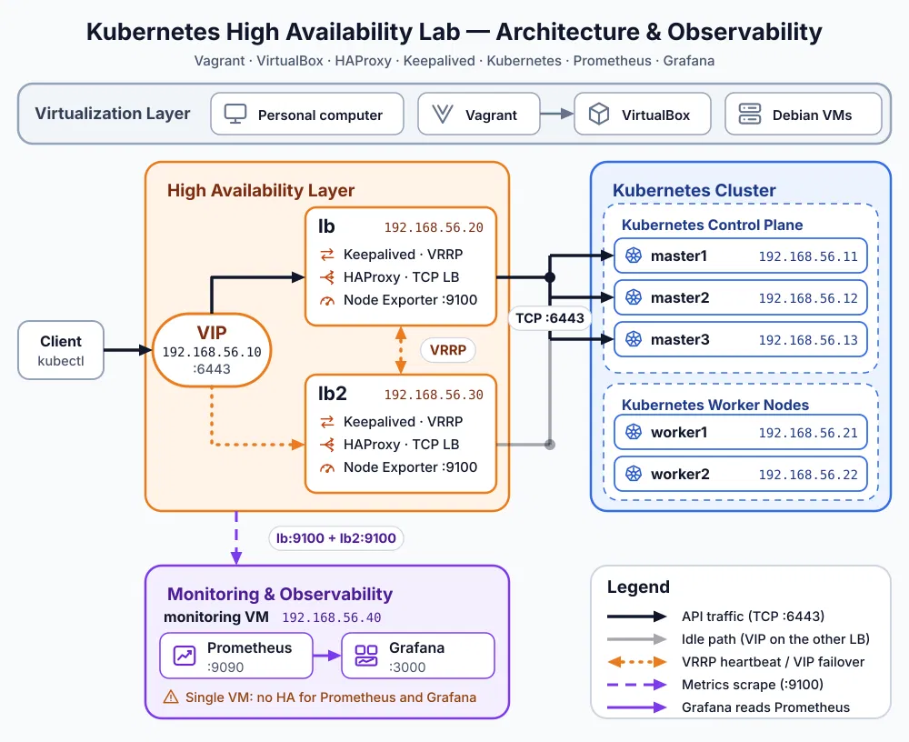

# Kubernetes High Availability Lab: DevOps & Observability


A hands-on DevOps project focused on Kubernetes high availability, load balancing, automated failover, and infrastructure monitoring and alerting.

## Overview

This project demonstrates how to build and monitor a Kubernetes high-availability lab using virtual machines managed by Vagrant and VirtualBox.

The infrastructure includes two load balancers configured with HAProxy and Keepalived, a virtual IP address for Kubernetes API access, three control-plane nodes, two worker nodes, and a dedicated monitoring VM running Prometheus and Grafana.

The project also implements custom Prometheus metrics to monitor HAProxy, Keepalived, and virtual IP ownership.

## Architecture


### Infrastructure Components

| Component | Hostname | IP address | Purpose |
| :--- | :--- | :--- | :--- |
| Load balancer | `lb1` | 192.168.56.20 | HAProxy, Keepalived, Node Exporter |
| Load balancer | `lb2` | 192.168.56.30 | HAProxy, Keepalived, Node Exporter |
| Virtual IP | `VIP` | 192.168.56.10 | Stable Kubernetes API endpoint |
| Control plane | `master1` | 192.168.56.11 | Kubernetes control plane |
| Control plane | `master2` | 192.168.56.12 | Kubernetes control plane |
| Control plane | `master3` | 192.168.56.13 | Kubernetes control plane |
| Worker node | `worker1` | 192.168.56.21 | Runs Kubernetes workloads |
| Worker node | `worker2` | 192.168.56.22 | Runs Kubernetes workloads |
| Monitoring | `monitoring` | 192.168.56.40 | Prometheus and Grafana |

## Technology Stack

- **Virtualization:** VirtualBox
- **Infrastructure management:** Vagrant
- **Operating system:** Debian Bookworm
- **Container orchestration:** Kubernetes, Kubeadm
- **Load balancing:** HAProxy
- **High availability:** Keepalived / VRRP
- **Metrics collection:** Prometheus Node Exporter
- **Monitoring and alerting:** Prometheus
- **Dashboards and visualization:** Grafana
- **Custom metrics:** Node Exporter Textfile Collector and systemd timer

## High Availability Design

The Kubernetes API is exposed through the virtual IP address `192.168.56.10`. 

HAProxy forwards TCP connections on port `6443` to the Kubernetes control-plane nodes:
- `master1:6443`
- `master2:6443`
- `master3:6443`

Keepalived uses VRRP to manage ownership of the virtual IP address between the two load balancers. 

Only one load balancer owns the VIP at a time. If the active load balancer becomes unavailable or fails the configured health checks, the standby load balancer can take over the VIP. Both load balancers run HAProxy and Keepalived.

## Monitoring and Observability

A dedicated monitoring VM runs Prometheus and Grafana. Node Exporter exposes system metrics from both load balancers on port `9100`.

Custom metrics are generated by a shell script and exposed through the Node Exporter Textfile Collector. The following metrics are currently implemented:

| Metric | Description |
| :--- | :--- |
| `haproxy_service_up` | Indicates whether HAProxy is active |
| `keepalived_service_up` | Indicates whether Keepalived is active |
| `vip_present` | Indicates whether the VIP is assigned to the local load balancer |

A systemd timer refreshes these custom metrics periodically.

### Monitoring Endpoints

| Service | Endpoint |
| :--- | :--- |
| **Prometheus** | `http://192.168.56.40:9090` |
| **Grafana** | `http://192.168.56.40:3000` |

### Example PromQL Queries

Check VIP ownership:
```promql
vip_present
```

Check HAProxy status:
```promql
haproxy_service_up
```

Check Keepalived status:
```promql
keepalived_service_up
```

Check whether Prometheus can scrape both load balancers:
```promql
up{job="load-balancers"}
```

## Validation and Failover Testing

The following tests have been performed:
- Verified that Prometheus collects metrics from both load balancers.
- Verified that the custom metrics are exposed by Node Exporter.
- Verified that the VIP is detected on the active load balancer.
- Verified that the standby load balancer reports that it does not own the VIP.
- Stopped Keepalived on the active load balancer to test VIP failover.
- Observed the VIP ownership change in Prometheus and Grafana.
- Verified that access to the Kubernetes API remained functional during the failover test.

The failover test was successful in the lab environment.

## Key Learning Outcomes

This project provided hands-on experience with:
- Designing a Kubernetes high-availability architecture.
- Managing virtual infrastructure with Vagrant and VirtualBox.
- Configuring HAProxy for Kubernetes API load balancing.
- Configuring Keepalived and VRRP for virtual IP failover.
- Exposing custom system and service metrics.
- Configuring Prometheus scraping targets.
- Building Grafana dashboards.
- Adding alert rules for load-balancer failures and VIP ownership.
- Testing high-availability behavior and validating monitoring data.
- Troubleshooting Linux services and systemd units.

## Current Limitations and Future Improvements

Potential next steps include:
- Monitoring all Kubernetes control-plane and worker nodes.
- Collecting HAProxy-specific traffic and backend health metrics.
- Automating more of the deployment with configuration management.
- Testing backup etcd snapshots and restore procedures.
- Documenting cluster recovery and failure scenarios.

---
**Author:** DevOps learning project focused on Kubernetes, high availability, automation, and observability.