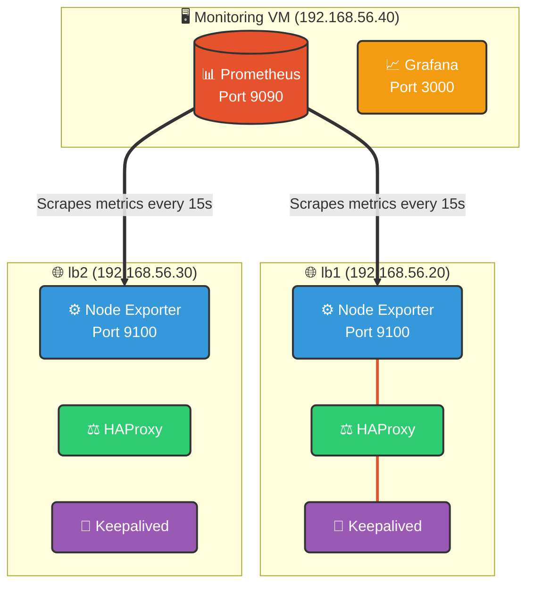
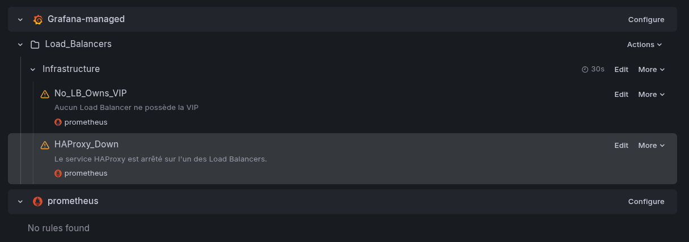
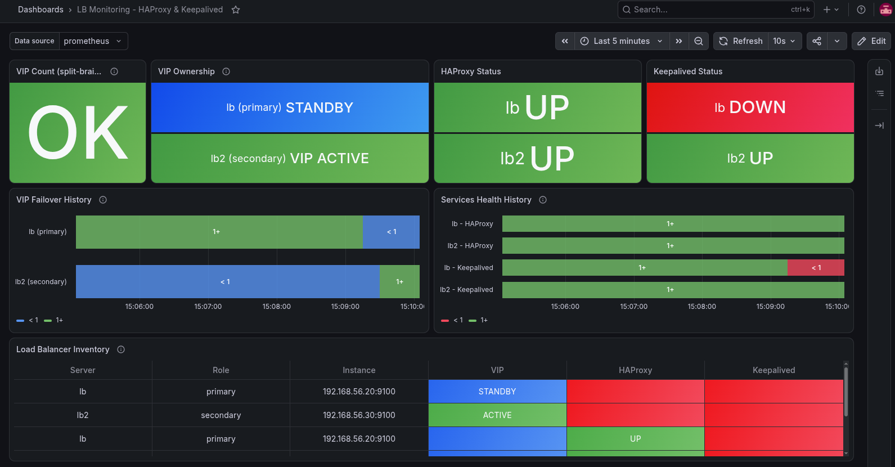
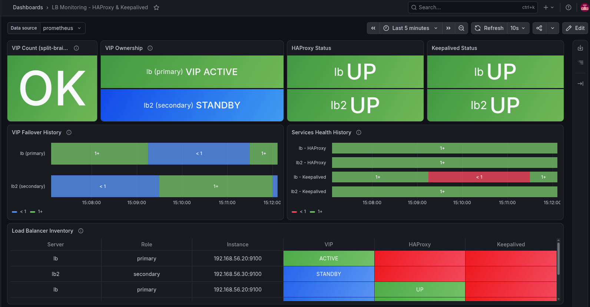
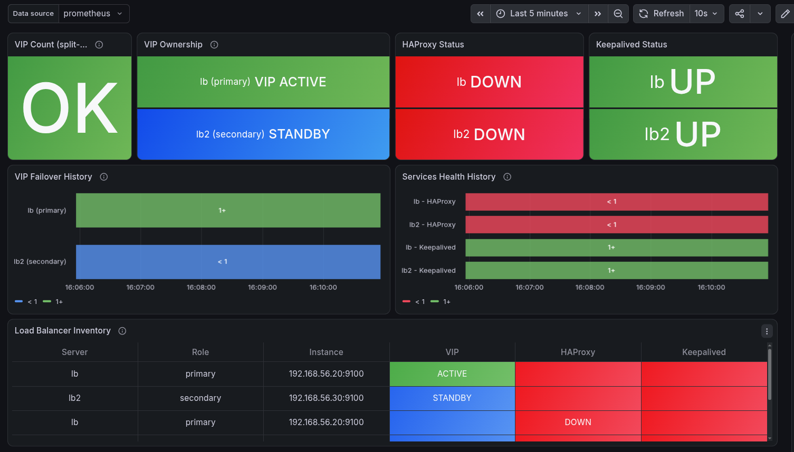

# 04. Monitoring and Observability with Prometheus and Grafana

## 1. Overview

This document describes the monitoring and observability implementation of the Kubernetes High Availability Lab.

The goal is to monitor the two load balancers, collect Linux system metrics, expose custom metrics for HAProxy and Keepalived, detect virtual IP ownership, and visualize the results in Grafana.

The monitoring infrastructure runs on a dedicated Debian Bookworm virtual machine.

**Monitoring objectives:**
* Collect system metrics from both load balancers.
* Monitor the status of HAProxy and Keepalived.
* Detect which load balancer currently owns the virtual IP address.
* Visualize monitoring data in Grafana.
* Validate monitoring behavior during a VIP failover.

## 2. Architecture

### Monitoring server

| Property | Value |
| :--- | :--- |
| **Hostname** | `monitoring` |
| **IP address** | `192.168.56.40` |
| **Operating system** | Debian Bookworm |
| **Metrics collection** | Prometheus |
| **Visualization** | Grafana |

### Monitored load balancers

| Hostname | IP address | Exporter port |
| :--- | :--- | :--- |
| **lb1** | `192.168.56.20` | `9100` |
| **lb2** | `192.168.56.30` | `9100` |

Node Exporter exposes metrics over HTTP on port `9100` by default.
Prometheus scrapes both exporters every 15 seconds.

### Monitoring data flow


The diagram illustrates the monitoring flow. Prometheus collects the metrics, and Grafana queries Prometheus to visualize them.

## 3. Prometheus Configuration

### 3.1. Configuration file

The Prometheus configuration file used in this lab is: `/etc/prometheus/prometheus.yml`

Before editing the file, create a backup:
```bash
sudo cp /etc/prometheus/prometheus.yml /etc/prometheus/prometheus.yml.bak
```

Edit the configuration:
```bash
sudo nano /etc/prometheus/prometheus.yml
```

The configuration used for this lab is:
```yaml
global:
  scrape_interval: 15s
  evaluation_interval: 15s

scrape_configs:
  - job_name: "prometheus"
    static_configs:
      - targets: ["localhost:9090"]

  - job_name: "load-balancers"
    static_configs:
      - targets:
        - "192.168.56.20:9100"
        labels:
          server: "lb1"
          role: "primary"
      - targets:
        - "192.168.56.30:9100"
        labels:
          server: "lb2"
          role: "secondary"
```

### 3.2. Configuration explanation

**Global configuration**
* `scrape_interval`: Prometheus collects metrics every 15 seconds.
* `evaluation_interval`: Prometheus evaluates configured rules every 15 seconds.

**Prometheus self-monitoring**
* `job_name: "prometheus"`: This job allows Prometheus to collect its own metrics.

**Load balancer monitoring**
* `job_name: "load-balancers"`: This job collects metrics from both Node Exporter instances.
The additional labels identify each monitored machine (`server="lb1"`, `server="lb2"`) and their configured role. The role labels are static configuration labels, they do not automatically change when the VIP moves.

### 3.3. Validate the configuration

Before restarting Prometheus, validate the YAML configuration:
```bash
sudo promtool check config /etc/prometheus/prometheus.yml
```
*Expected result:* `SUCCESS: /etc/prometheus/prometheus.yml is valid prometheus config file syntax`

Restart Prometheus and check its status:
```bash
sudo systemctl restart prometheus
sudo systemctl status prometheus --no-pager
```

## 4. Node Exporter Installation and Verification

Node Exporter exposes Linux system metrics such as CPU usage, memory, filesystem capacity, and network statistics. It runs on both load balancers.

### 4.1. Install Node Exporter

On Debian systems, run this on both `lb1` and `lb2`:
```bash
sudo apt update
sudo apt install prometheus-node-exporter
```

### 4.2. Check the service

On each load balancer:
```bash
sudo systemctl status prometheus-node-exporter --no-pager
```
If necessary, enable and start the service:
```bash
sudo systemctl enable --now prometheus-node-exporter
```

### 4.3. Verify the exporter endpoint

On `lb1`:
```bash
curl -s http://localhost:9100/metrics | head
```

From the monitoring VM, test network connectivity to both exporters:
```bash
curl -s http://192.168.56.20:9100/metrics | head
curl -s http://192.168.56.30:9100/metrics | head
```

## 5. Configure the Textfile Collector

The Textfile Collector allows Node Exporter to expose custom metrics written to `.prom` files.

### 5.1. Configure the collector directory

On both load balancers, edit the configuration file:
```bash
cat /etc/default/prometheus-node-exporter
```
Ensure the configured arguments are:
```text
ARGS="--collector.textfile.directory=/var/lib/prometheus/node-exporter"
```

Create the directory and set its permissions:
```bash
sudo mkdir -p /var/lib/prometheus/node-exporter
sudo chown prometheus:prometheus /var/lib/prometheus/node-exporter
sudo chmod 755 /var/lib/prometheus/node-exporter
```

Restart Node Exporter if its configuration has changed:
```bash
sudo systemctl restart prometheus-node-exporter
```

## 6. Custom High Availability Metrics

Three custom metrics are exposed on each load balancer:

| Metric | Value | Meaning |
| :--- | :--- | :--- |
| `haproxy_service_up` | 1 | HAProxy is active |
| `haproxy_service_up` | 0 | HAProxy is not active |
| `keepalived_service_up` | 1 | Keepalived is active |
| `keepalived_service_up` | 0 | Keepalived is not active |
| `vip_present` | 1 | The VIP is assigned to the local machine |
| `vip_present` | 0 | The VIP is not assigned to the local machine |

### 6.1. Create the monitoring script

On each load balancer, create the script:
```bash
sudo nano /usr/local/bin/ha-metrics.sh
```
The contents of the script are in  `../scripts/ha-metrics.sh`.

Make the script executable:
```bash
sudo chmod +x /usr/local/bin/ha-metrics.sh
```

### 6.2. Test the script manually

Run the script and inspect the output:
```bash
sudo /usr/local/bin/ha-metrics.sh
cat /var/lib/prometheus/node-exporter/ha_metrics.prom
```

### 6.3. Verify the metrics through Node Exporter

```bash
curl -s http://localhost:9100/metrics | grep -E '^(haproxy_service_up|keepalived_service_up|vip_present)'
```

## 7. Automate Metric Updates with systemd

### 7.1. Create the service

On both load balancers:
```bash
sudo nano /etc/systemd/system/ha-metrics.service
```

**Contents:**
```ini
[Unit]
Description=Collect HAProxy, Keepalived and VIP metrics

[Service]
Type=oneshot
ExecStart=/bin/bash /usr/local/bin/ha-metrics.sh
```

### 7.2. Create the timer

```bash
sudo nano /etc/systemd/system/ha-metrics.timer
```

**Contents:**
```ini
[Unit]
Description=Refresh HA metrics every 15 seconds

[Timer]
OnBootSec=10s
OnUnitActiveSec=15s
AccuracySec=1s
Unit=ha-metrics.service

[Install]
WantedBy=timers.target
```

### 7.3. Enable the timer

```bash
sudo systemctl daemon-reload
sudo systemctl enable --now ha-metrics.timer
sudo systemctl start ha-metrics.service
```

### 7.4. Validate execution

```bash
systemctl is-active ha-metrics.timer
sudo systemctl show ha-metrics.service -p Result -p ExecMainStatus
```

*Expected output: `Result=success` and `ExecMainStatus=0`*

## 8. Verify Targets in Prometheus

Open the Prometheus targets page: `http://192.168.56.40:9090/targets`

The following targets should be available and in the `UP` state:
* `prometheus` (`localhost:9090`)
* `load-balancers` (`192.168.56.20:9100`)
* `load-balancers` (`192.168.56.30:9100`)

## 9. Validate Metrics in Prometheus

Open the Prometheus expression browser: `http://192.168.56.40:9090/graph`

Execute the following queries:
* HAProxy status: `haproxy_service_up`
* Keepalived status: `keepalived_service_up`
* VIP ownership: `vip_present`
* Exporter availability: `up{job="load-balancers"}`
* Detect if no LB owns the VIP: `sum(vip_present) == 0`

## 10. Configure Grafana

Open Grafana at: `http://192.168.56.40:3000`

### 10.1. Configure the Prometheus data source
1. Open **Connections** > **Data sources**.
2. Add the **Prometheus** data source.
3. Set the URL to: `http://localhost:9090`
4. Click **Save & test**.

### 10.2. Create the HA dashboard
For the dashboard, I used a custom one in `/monitoring/lb-haproxy-dashboard.json`.

for use it go to **Create** > **Import** and upload the JSON file.

## 11. Configure Alerting in Grafana

Grafana can evaluate metrics and send email notifications when something goes wrong (e.g., a service stops or the VIP is lost).

### 11.1. Configure SMTP with Ethereal Email (Testing)
To test email alerts without using a real email account, I use **Ethereal Email**, a fake SMTP service.

1. Go to [https://ethereal.email/create](https://ethereal.email/create) to generate temporary SMTP credentials.
2. On the **Monitoring VM**, edit the Grafana configuration file:
   ```bash
   sudo nano /etc/grafana/grafana.ini
   ```
3. Locate the `[smtp]` section. **Uncomment** the required lines by removing the semicolon (`;`) at the beginning, and fill them with your Ethereal credentials. Ensure you use port `587` and `skip_verify = true` to avoid encryption issues:
   ```ini
   [smtp]
   enabled = true
   host = smtp.ethereal.email:587
   user = <your_ethereal_email_address>
   password = <your_ethereal_password>
   skip_verify = true
   from_address = <your_ethereal_email_address>
   from_name = Grafana Alerts
   ```
   *Note: Make sure `startTLS_policy` remains commented out (` ;startTLS_policy = NoStartTLS `) so Grafana uses STARTTLS securely.*
4. Restart Grafana to apply the changes:
   ```bash
   sudo systemctl restart grafana-server
   ```
### 11.2. Create a Contact Point
1. In Grafana, navigate to **Alerting** > **Contact points**.
2. Click **+ Add contact point**.
3. Name it (e.g., `Infra_Team_Email`).
4. Set Integration to **Email**.
5. Enter the target email address (e.g., the Ethereal address).
6. Click **Test** to ensure the SMTP configuration works. Check the "Messages" tab on the Ethereal website to view the intercepted test email.
7. Click **Save contact point**.

### 11.3. Alert Rule 1: No_LB_Owns_VIP
This alert triggers if neither load balancer currently holds the Virtual IP.

1. Go to **Alerting** > **Alert rules** > **New alert rule**.
2. **Name:** `No_LB_Owns_VIP`
3. **Query:**
   * In the PromQL field, enter: `sum(vip_present)`
   * Set the Alert Condition below to: `WHEN QUERY IS EQUAL TO 0`
4. **Evaluation behavior:**
   * Create a new folder (e.g., `Load_Balancers`) and evaluation group (e.g., `1m`).
   * Set **Pending period** to `30s`. This delay prevents false positives during a normal failover transition.
5. Save the rule.

### 11.4. Alert Rule 2: HAProxy_Down
This alert triggers if the HAProxy service stops on any individual Load Balancer.

1. Create a **New alert rule**.
2. **Name:** `HAProxy_Down`
3. **Query:**
   * In the PromQL field, enter the raw metric: `haproxy_service_up` *(Do not add `== 0` here to prevent "DatasourceNoData" errors)*.
   * Set the Alert Condition below to: `WHEN QUERY IS EQUAL TO 0`
4. **Evaluation behavior:**
   * Set **Pending period** to `30s` for immediate detection.
5. **Summary / Annotations:** Add a clear message (e.g., "HAProxy service is down on a Load Balancer. Connect via SSH and run systemctl restart haproxy").
6. Save the rule.



## 12. VIP Failover & Alert Testing

### 12.1. Simulate a failure

On the load balancer currently holding the VIP, stop Keepalived:
```bash
sudo systemctl stop keepalived
```

### 12.2. Observe the failover

Check the VIP on both machines:
```bash
ip -o addr show | grep '192.168.56.10'
```
Also inspect the Prometheus query `vip_present` in Grafana to see the state shift from `lb1` to `lb2`.



### 12.3. Verify Kubernetes API access

```bash
kubectl get nodes
```
The command should return the cluster nodes if the API endpoint and the remaining load balancer are functioning correctly.

### 12.4. Restore the service

Restart Keepalived on the machine where it was stopped:
```bash
sudo systemctl start keepalived
```



### 12.5. Test the HAProxy Alert
1. SSH into `lb1 & lb2` and stop the HAProxy service:
   ```bash
   sudo systemctl stop haproxy
   ```
2. Check Grafana Alerting. `HAProxy_Down` will transition from Normal to Pending, then to Firing.



3. Check Ethereal Email to confirm the notification was received.


4. Restart the service: `sudo systemctl start haproxy`.

### 12.6. Test the VIP Failover & Alert
1. On the load balancer currently holding the VIP (e.g., `lb1`), stop Keepalived:
   ```bash
   sudo systemctl stop keepalived
   ```
2. Check the VIP on both machines (`ip -o addr show | grep '192.168.56.10'`). It should instantly migrate to `lb2`.
3. Stop Keepalived on `lb2` as well to simulate a total failure:
   ```bash
   sudo systemctl stop keepalived
   ```
4. Wait 30 seconds. The `No_LB_Owns_VIP` alert will fire in Grafana, and an email will be dispatched.
5. Restore the services:
   ```bash
   sudo systemctl start keepalived
   ```

## 12. Troubleshooting

* **Node Exporter metrics missing:** Check `sudo systemctl status prometheus-node-exporter` and network connectivity on port `9100`.
* **Custom metrics missing:** Run the script manually `sudo /bin/bash /usr/local/bin/ha-metrics.sh` and inspect the output in `/var/lib/prometheus/node-exporter/ha_metrics.prom`.
* **systemd reports 203/EXEC:** Ensure the script is executable (`chmod +x`) and the service uses the explicit bash invocation (`ExecStart=/bin/bash ...`).
## 13. Conclusion

This monitoring implementation provides visibility into the two load balancers and their high-availability behavior. The successful VIP failover test demonstrates how observability helps validate high availability and troubleshoot infrastructure behavior.