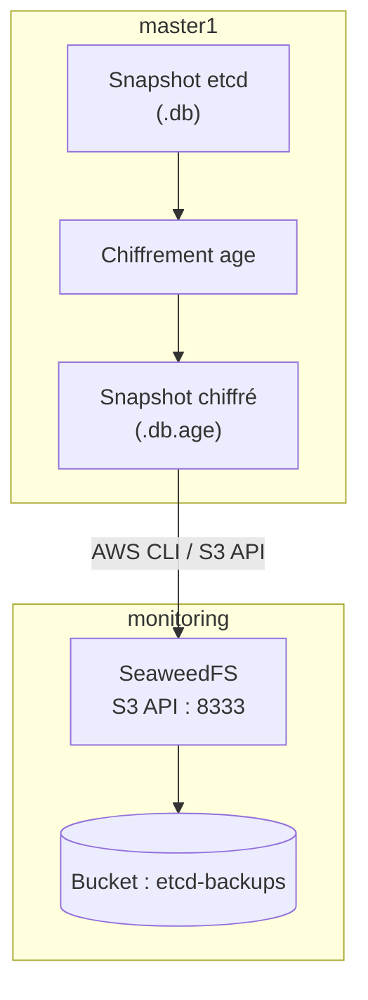

## 5. SeaweedFS Installation and Configuration

### 5.1 Overview

SeaweedFS is used as an object storage solution to keep the encrypted etcd backups.

It is deployed on the `monitoring` machine at `192.168.56.40` using Docker Compose.

SeaweedFS exposes an S3-compatible API that allows the AWS CLI to send and retrieve files.

**Architecture:**



### 5.2 Prerequisites

On the `monitoring` machine, Docker and Docker Compose must be installed.

Verify their availability:

```bash
docker --version
docker compose version
```

If Docker is not installed, you must first install the Docker Engine and the Docker Compose plugin by following the official documentation:

https://docs.docker.com/engine/install/debian/

### 5.3 Create Storage Directories

On `monitoring`:

```bash
sudo mkdir -p /opt/seaweedfs
sudo mkdir -p /srv/seaweedfs
```

The `/opt/seaweedfs` directory contains the Docker Compose configuration.

The `/srv/seaweedfs` directory contains the persistent data for SeaweedFS.

Set the correct permissions:

```bash
sudo chmod 700 /opt/seaweedfs
sudo chmod 700 /srv/seaweedfs
```

### 5.4 Generate S3 Credentials

S3 credentials are stored in a `.env` file.

On `monitoring`:

```bash
sudo bash -c '
umask 077
cat > /opt/seaweedfs/.env <<EOF
S3_ACCESS_KEY=backupadmin
S3_SECRET_KEY=$(openssl rand -hex 32)
EOF
'
```

Verify the permissions without displaying the content:

```bash
sudo ls -l /opt/seaweedfs/.env
```

The file must be accessible only to root.

Never publish this file on GitHub.

### 5.5 Create the Docker Compose File

Create the file:

```bash
sudo nano /opt/seaweedfs/compose.yaml
```

Configuration used:

```yaml
services:
  seaweedfs:
    image: chrislusf/seaweedfs:latest
    container_name: seaweedfs
    restart: unless-stopped

    command:
      - mini
      - -dir=/data

    env_file:
      - .env

    environment:
      AWS_ACCESS_KEY_ID: ${S3_ACCESS_KEY}
      AWS_SECRET_ACCESS_KEY: ${S3_SECRET_KEY}
      S3_BUCKET: etcd-backups

    ports:
      - "192.168.56.40:8333:8333"

    volumes:
      - /srv/seaweedfs:/data

    stop_grace_period: 30s
```

**Configuration Explanation:**

| Parameter | Description |
|---|---|
| `image` | Official SeaweedFS Docker image |
| `container_name` | Container name |
| `restart` | Automatic container restart policy |
| `mini` | Starts SeaweedFS in Mini mode |
| `-dir=/data` | Data storage directory |
| `env_file` | Loads variables from the `.env` file |
| `8333` | S3 API port |
| `/srv/seaweedfs:/data` | Data persistence on the host |
| `stop_grace_period` | Time allowed for the container to stop gracefully |

The S3 port is bound to the address `192.168.56.40` to avoid exposing it on all of the VM's network interfaces.

### 5.6 Start SeaweedFS

Navigate to the directory:

```bash
cd /opt/seaweedfs
```

Validate the Compose configuration:

```bash
sudo docker-compose config
```

Start the service:

```bash
sudo docker-compose up -d
```

Verify the container is running:

```bash
sudo docker-compose ps
```

Check the logs:

```bash
sudo docker-compose logs -f seaweedfs
```

### 5.7 Verify the S3 API

The S3 endpoint is:

```text
http://192.168.56.40:8333
```

The API must be accessible from `master1`.

On `monitoring`, verify that the port is listening:

```bash
sudo ss -lntp | grep 8333
```

On `master1`, test network connectivity:

```bash
curl -I http://192.168.56.40:8333
```

An HTTP response (even other than `200`) verifies that the server is responding on this port. The actual functional test is done using the AWS CLI.

### 5.8 Create and Verify the S3 Bucket

The bucket used for backups is:

```text
etcd-backups
```

On `monitoring`, credentials are defined in `/opt/seaweedfs/.env`.

To use them with the AWS CLI:

```bash
set -a
source /opt/seaweedfs/.env
set +a

export AWS_ACCESS_KEY_ID="$S3_ACCESS_KEY"
export AWS_SECRET_ACCESS_KEY="$S3_SECRET_KEY"
export AWS_DEFAULT_REGION="us-east-1"
```

Check available buckets:

```bash
aws --endpoint-url http://192.168.56.40:8333 s3 ls
```

If the bucket does not exist, create it:

```bash
aws --endpoint-url http://192.168.56.40:8333 \
  s3 mb s3://etcd-backups
```

Verify its presence:

```bash
aws --endpoint-url http://192.168.56.40:8333 \
  s3 ls s3://etcd-backups/
```

### 5.9 Test Object Upload and Retrieval

Before using SeaweedFS for etcd backups, a test file allows you to validate the S3 API functionality.

Create a file:

```bash
echo "SeaweedFS S3 test" > /tmp/seaweedfs-test.txt
```

Upload the file:

```bash
aws --endpoint-url http://192.168.56.40:8333 \
  s3 cp /tmp/seaweedfs-test.txt \
  s3://etcd-backups/seaweedfs-test.txt
```

Verify its presence:

```bash
aws --endpoint-url http://192.168.56.40:8333 \
  s3 ls s3://etcd-backups/
```

Download the file:

```bash
aws --endpoint-url http://192.168.56.40:8333 \
  s3 cp s3://etcd-backups/seaweedfs-test.txt \
  /tmp/seaweedfs-test-download.txt
```

Compare the files:

```bash
diff /tmp/seaweedfs-test.txt \
     /tmp/seaweedfs-test-download.txt
```

No output from the `diff` command means the files are identical.

### 5.10 Data Persistence

SeaweedFS data is stored in:

```text
/srv/seaweedfs
```

This directory is mounted in the Docker container at `/data`.

As a result, the data remains persistent even when the container is stopped or restarted.

Check the data size:

```bash
sudo du -sh /srv/seaweedfs
```

Restart SeaweedFS:

```bash
cd /opt/seaweedfs
sudo docker-compose restart
```

Verify that the bucket and objects are still available:

```bash
aws --endpoint-url http://192.168.56.40:8333 \
  s3 ls s3://etcd-backups/
```

### 5.11 SeaweedFS Administration Commands

| Action | Command |
|---|---|
| View containers | `sudo docker-compose ps` |
| Start | `sudo docker-compose up -d` |
| Stop | `sudo docker-compose down` |
| Restart | `sudo docker-compose restart` |
| View logs | `sudo docker-compose logs -f seaweedfs` |
| Check disk space | `df -h` |
| View data size | `sudo du -sh /srv/seaweedfs` |

To run Compose commands, navigate to `/opt/seaweedfs`.

**Warning:** Do not delete `/srv/seaweedfs` during maintenance without checking and backing up the data it contains first.

### 5.12 Security and Limitations

- The `.env` file contains S3 credentials and must not be published.
- The S3 API is bound to the private address `192.168.56.40`.
- Backups sent to SeaweedFS are encrypted with age prior to transfer.
- The private age key is kept separately on `monitoring`.
- SeaweedFS storage currently relies on the disk of the `monitoring` VM.
- Losing this VM or its disk could result in the loss of remote backups.

For a production environment, it would be highly recommended to deploy SeaweedFS on independent infrastructure, implementing a robust replication, backup, and access control strategy.

---

## 6. S3 Access Configuration from master1

Once SeaweedFS is operational, `master1` uses the AWS CLI to communicate with the `etcd-backups` bucket.

Create the credentials file:

```bash
sudo install -m 600 /dev/null /etc/etcd-backup-s3.env
sudo nano /etc/etcd-backup-s3.env
```

Content:

```bash
AWS_ACCESS_KEY_ID="ACCESS_KEY"
AWS_SECRET_ACCESS_KEY="SECRET_KEY"
AWS_DEFAULT_REGION="us-east-1"
```

Load the variables:

```bash
set -a
source /etc/etcd-backup-s3.env
set +a
```

Test access:

```bash
aws --endpoint-url http://192.168.56.40:8333 \
  s3 ls s3://etcd-backups/
```

The following sections of the document cover the creation of etcd snapshots, their encryption using age, their transfer, and automation with systemd.