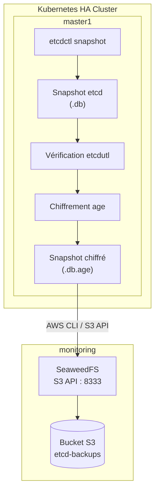

# 06. Automated and Encrypted etcd Backup with SeaweedFS

## 1. Objective

This part of the project sets up an automated backup system for the etcd datastore used by the HA Kubernetes cluster.

The etcd snapshots are:

* Created from the `master1` node.
* Verified using `etcdutl`.
* Encrypted with `age` prior to transfer.
* Sent to SeaweedFS via its S3-compatible API.
* Verified after the transfer.
* Kept locally for a limited retention period.

The execution is automated using a systemd service and timer.

### Architecture



## 2. Environment Information

| Element | Configuration | 
| ----- | ----- | 
| Backup node | `master1` | 
| master1 address | `192.168.56.11` | 
| Storage server | `monitoring` | 
| monitoring address | `192.168.56.40` | 
| Object storage | SeaweedFS | 
| S3 Endpoint | `http://192.168.56.40:8333` | 
| Bucket | `etcd-backups` | 
| Encryption | age | 
| Backup tool | etcdctl | 
| Verification | etcdutl | 
| Transfer | AWS CLI | 
| Automation | systemd timer | 
| Frequency | Every day at 02:00 | 

**Versions observed during testing:**

* `etcdctl`: 3.6.8
* etcd snapshot version: 3.6.0
* AWS CLI: 2.9.19

## 3. Tool Installation

The following commands are executed on `master1`.

### 3.1 Install AWS CLI

AWS CLI is used to communicate with the SeaweedFS S3 API.

```bash
sudo apt update
sudo apt install -y awscli

```

Verification:

```bash
aws --version

```

### 3.2 Install age

`age` is used to encrypt snapshots before transferring them to remote storage.
On Debian, if the package is available:

```bash
sudo apt update
sudo apt install -y age

```

Verification:

```bash
age --version

```
### 3.3 Install etcdutl

```bash
curl -fLO https://github.com/etcd-io/etcd/releases/download/v3.6.8/etcd-v3.6.8-linux-amd64.tar.gz
```
```bash
tar -xzf etcd-v3.6.8-linux-amd64.tar.gz \
  etcd-v3.6.8-linux-amd64/etcdutl
```
```bash
sudo install -m 0755 \
  /tmp/etcd-v3.6.8-linux-amd64/etcdutl \
  /usr/local/bin/etcdutl
```

### 3.3 Verify etcdctl and etcdutl

```bash
command -v etcdctl
command -v etcdutl

```

Versions:

```bash
etcdctl version
etcdutl version

```

*The versions of etcdctl and etcdutl must be compatible with the etcd version used by the cluster.*

## 4. Encryption Configuration with age

Asymmetric encryption allows backups to be encrypted on `master1` without storing the private key there.

* The private key is kept on `monitoring`.
* The public key is installed on `master1`.
* `master1` only uses the public key to encrypt snapshots.
* `monitoring` uses the private key to decrypt them.

### 4.1 Generate the Key Pair on monitoring

Create the directory:

```bash
sudo install -d -m 700 /etc/etcd-backup

```

Generate the private key:

```bash
sudo sh -c 'umask 077; age-keygen -o /etc/etcd-backup/age-identity.txt'

```

Display the corresponding public key:

```bash
sudo age-keygen -y /etc/etcd-backup/age-identity.txt

```

*The output must start with `age1`.*

**Important:** The private key `age-identity.txt` must never be copied to `master1`, to the Git repository, or into the S3 bucket.

### 4.2 Install the Public Key on master1

Create the file:

```bash
sudo nano /etc/etcd-backup-recipient.txt

```

Paste the public key `age1...` obtained previously into this file.

Protect the file:

```bash
sudo chmod 644 /etc/etcd-backup-recipient.txt

```

## 5. SeaweedFS and S3 Access Configuration

SeaweedFS is deployed on the `monitoring` machine with Docker Compose.

* The S3 API is accessible at: `http://192.168.56.40:8333`
* The bucket used for backups is: `etcd-backups`
* S3 credentials are defined in the file: `/opt/seaweedfs/.env`

Structure example:

```text
S3_ACCESS_KEY=...
S3_SECRET_KEY=...

```

*Real values must never be published in Git.*

### 5.1 Configure Credentials on master1

Create a protected file:

```bash
sudo install -m 600 /dev/null /etc/etcd-backup-s3.env

```

Edit it:

```bash
sudo nano /etc/etcd-backup-s3.env

```

Content:

```bash
AWS_ACCESS_KEY_ID="ACCESS_KEY"
AWS_SECRET_ACCESS_KEY="SECRET_KEY"
AWS_DEFAULT_REGION="us-east-1"

```

*Replace the placeholder values with the actual S3 credentials.*

Protect the file:

```bash
sudo chmod 600 /etc/etcd-backup-s3.env

```

### 5.2 Test the S3 Connection

Load the variables in the terminal:

```bash
set -a
source /etc/etcd-backup-s3.env
set +a

```

Verify access to the bucket:

```bash
aws --endpoint-url http://192.168.56.40:8333 \
  s3 ls s3://etcd-backups/

```

*The bucket must be accessible without authentication errors.*

## 6. Creating an etcd Snapshot

Snapshots are saved in: `/var/backups/etcd/`

Create the directory with restrictive permissions:

```bash
sudo install -d -m 700 /var/backups/etcd

```

The backup command used:

```bash
sudo etcdctl \
  --endpoints=https://127.0.0.1:2379 \
  --cacert=/etc/kubernetes/pki/etcd/ca.crt \
  --cert=/etc/kubernetes/pki/etcd/healthcheck-client.crt \
  --key=/etc/kubernetes/pki/etcd/healthcheck-client.key \
  snapshot save "/var/backups/etcd/etcd-$(date +%Y%m%d-%H%M%S).db"

```

*This command uses the health check client certificate and the etcd Certificate Authority to communicate with the local endpoint.*

## 7. Snapshot Verification

After creating the snapshot, verify its integrity with `etcdutl`:

```bash
sudo etcdutl snapshot status \
  /var/backups/etcd/etcd-YYYYMMDD-HHMMSS.db \
  --write-out=table

```

Example obtained during testing:

```text
+----------+----------+------------+------------+---------+
|   HASH   | REVISION | TOTAL KEYS | TOTAL SIZE | VERSION |
+----------+----------+------------+------------+---------+
| 89e8402d |   177602 |        546 |      27 MB |   3.6.0 |
+----------+----------+------------+------------+---------+

```

## 8. Snapshot Encryption

The snapshot is encrypted using the `age` public key:

```bash
sudo age -R /etc/etcd-backup-recipient.txt \
  -o /var/backups/etcd/etcd-YYYYMMDD-HHMMSS.db.age \
  /var/backups/etcd/etcd-YYYYMMDD-HHMMSS.db

```

Protect the permissions:

```bash
sudo chmod 600 /var/backups/etcd/*.db.age

```

*The `.db.age` file is the encrypted version intended for remote storage.*

## 9. Transfer to SeaweedFS

The transfer is done using the AWS CLI:

```bash
sudo aws --endpoint-url http://192.168.56.40:8333 \
  s3 cp \
  /var/backups/etcd/etcd-YYYYMMDD-HHMMSS.db.age \
  s3://etcd-backups/

```

Verify the file's presence:

```bash
aws --endpoint-url http://192.168.56.40:8333 \
  s3 ls s3://etcd-backups/

```

*The file should appear in the bucket.*

## 10. Automated Backup Script

The main script is located at `../scripts/etcd-backup.sh` and is copied to `/usr/local/bin/etcd-backup.sh`.

It executes the following operations:

1. Loads the S3 credentials.
2. Creates an etcd snapshot.
3. Verifies the snapshot with `etcdutl`.
4. Encrypts it with `age`.
5. Transfers the encrypted file to SeaweedFS.
6. Verifies the presence of the remote object.
7. Cleans up old local backups.

The script is protected:

```bash
sudo chmod 700 /usr/local/bin/etcd-backup.sh

```

To run a backup manually:

```bash
sudo /usr/local/bin/etcd-backup.sh

```
Example output:

```text
[Sat Oct 31 22:58:50 UTC 2026] Début de la sauvegarde etcd
{"level":"info","ts":"2026-10-31T22:58:50.721312Z","caller":"snapshot/v3_snapshot.go:83","msg":"created temporary db file","path":"/var/backups/etcd/etcd-20261031-225850.db.part"}
{"level":"info","ts":"2026-10-31T22:58:50.727000Z","logger":"client","caller":"v3@v3.6.8/maintenance.go:236","msg":"opened snapshot stream; downloading"}
{"level":"info","ts":"2026-10-31T22:58:50.737212Z","caller":"snapshot/v3_snapshot.go:96","msg":"fetching snapshot","endpoint":"https://127.0.0.1:2379"}
{"level":"info","ts":"2026-10-31T22:58:51.024897Z","logger":"client","caller":"v3@v3.6.8/maintenance.go:302","msg":"completed snapshot read; closing"}
{"level":"info","ts":"2026-10-31T22:58:51.042778Z","caller":"snapshot/v3_snapshot.go:111","msg":"fetched snapshot","endpoint":"https://127.0.0.1:2379","size":"27 MB","took":"320.979892ms","etcd-version":"3.6.0"}
{"level":"info","ts":"2026-10-31T22:58:51.042874Z","caller":"snapshot/v3_snapshot.go:121","msg":"saved","path":"/var/backups/etcd/etcd-20261031-225850.db"}
Snapshot saved at /var/backups/etcd/etcd-20261031-225850.db
Server version 3.6.0
+----------+----------+------------+------------+---------+
|   HASH   | REVISION | TOTAL KEYS | TOTAL SIZE | VERSION |
+----------+----------+------------+------------+---------+
| 89e8402d |   177602 |        546 |      27 MB |   3.6.0 |
+----------+----------+------------+------------+---------+
upload: ../../var/backups/etcd/etcd-20261031-225850.db.age to s3://etcd-backups/etcd-20261031-225850.db.age
[Sat Oct 31 22:58:52 UTC 2026] Sauvegarde terminée avec succès : etcd-20261031-225850.db.age
```

To list local backups:

```bash
sudo ls -lh /var/backups/etcd/

```
Example output:

```text
-rw------- 1 root root  27M Oct 31 22:58 etcd-20261031-225850.db
-rw------- 1 root root  27M Oct 31 22:58 etcd-20261031-225850.db.age
```

To list remote backups:

```bash
aws --endpoint-url http://192.168.56.40:8333 \
  s3 ls s3://etcd-backups/

```
Example output:

```text
2026-10-31 22:58:52   28311552 etcd-20261031-225850.db.age
``` 

## 11. Automation with systemd

Two systemd files are used.

### 11.1 Service

File: `/etc/systemd/system/etcd-backup.service`

Configuration:

```ini
[Unit]
Description=Automated etcd backup and encryption
Wants=network-online.target
After=network-online.target

[Service]
Type=oneshot
User=root
ExecStart=/usr/local/bin/etcd-backup.sh

```

*This service executes the backup script once every time it is triggered.*

### 11.2 Timer

File: `/etc/systemd/system/etcd-backup.timer`

Configuration:

```ini
[Unit]
Description=Daily etcd backup at 02:00

[Timer]
OnCalendar=*-*-* 02:00:00
Persistent=true

[Install]
WantedBy=timers.target

```

*The timer automatically triggers the service every day at 02:00.*

### 11.3 Enable the Timer

Reload the systemd configuration:

```bash
sudo systemctl daemon-reload

```

Enable and start the timer:

```bash
sudo systemctl enable --now etcd-backup.timer

```

Check its status:

```bash
systemctl status etcd-backup.timer

```

Show the next execution time:

```bash
systemctl list-timers etcd-backup.timer

```

### 11.4 Check Logs

Show the service logs:

```bash
sudo journalctl -u etcd-backup.service

```

Show the logs for the last execution:

```bash
sudo journalctl -u etcd-backup.service -n 50

```

Follow the logs in real-time:

```bash
sudo journalctl -u etcd-backup.service -f

```

To manually trigger the service via systemd:

```bash
sudo systemctl start etcd-backup.service

```

## 12. Decryption Test and SHA-256 Check

A decryption test ensures that the backups stored on SeaweedFS can be recovered.

### 12.1 Calculate the Hash of the Original Snapshot

On `master1`:

```bash
sudo sha256sum /var/backups/etcd/etcd-YYYYMMDD-HHMMSS.db

```

Also calculate the hash of the encrypted file:

```bash
sudo sha256sum /var/backups/etcd/etcd-YYYYMMDD-HHMMSS.db.age

```

### 12.2 Download the Encrypted File

On `monitoring`:

```bash
sudo mkdir -p /tmp/etcd-restore-test
sudo chmod 700 /tmp/etcd-restore-test

```

Load the S3 credentials:

```bash
set -a
source /opt/seaweedfs/.env
set +a

export AWS_ACCESS_KEY_ID="$S3_ACCESS_KEY"
export AWS_SECRET_ACCESS_KEY="$S3_SECRET_KEY"
export AWS_DEFAULT_REGION="us-east-1"

```

Download the snapshot:

```bash
sudo -E aws --endpoint-url http://192.168.56.40:8333 \
  s3 cp \
  s3://etcd-backups/etcd-YYYYMMDD-HHMMSS.db.age \
  /tmp/etcd-restore-test/

```

*Compare the hash of the downloaded file with that of the original encrypted file.*

### 12.3 Decrypt the Snapshot

On `monitoring`:

```bash
sudo age -d \
  -i /etc/etcd-backup/age-identity.txt \
  -o /tmp/etcd-restore-test/etcd-restore.db \
  /tmp/etcd-restore-test/etcd-YYYYMMDD-HHMMSS.db.age

```

### 12.4 Compare the Hash of the Decrypted Snapshot

```bash
sudo sha256sum /tmp/etcd-restore-test/etcd-restore.db

```

*The result must be strictly identical to the SHA-256 of the original snapshot calculated on `master1`.*
This verification confirms that the decrypted file matches the source file exactly.

### 12.5 Verify the Decrypted Snapshot

With `etcdutl`:

```bash
sudo etcdutl snapshot status \
  /tmp/etcd-restore-test/etcd-restore.db \
  --write-out=table

```

The revision, total keys, and total size information must be consistent with the original snapshot.

**Warning:** This test verifies the download, decryption, and integrity of the snapshot. It does not replace a true etcd restore drill in an isolated environment.

Clean up the temporary decrypted file after validation:

```bash
sudo rm -f /tmp/etcd-restore-test/etcd-restore.db

```

## 14. Security and Best Practices

Some important rules:

* Never publish S3 keys in GitHub.
* Never publish the private `age` key.
* Keep sensitive configuration files with `600` permissions.
* Only transfer encrypted snapshots to remote storage.
* Never perform a restore test directly on the production Kubernetes cluster.
* Ideally, keep a copy of the private `age` key in a secure location independent of the `monitoring` VM.
* Plan for a copy of the backups on storage independent of the SeaweedFS server.

*Current laboratory limitation: SeaweedFS and the monitoring services are hosted on the same VM. The complete loss of this VM or its disk could therefore lead to the loss of remote backups.*

Local retention is configured to 7 days in the script. The remote retention policy must be defined separately.

## 15. Future Improvements

* Add a Prometheus/Grafana alert in case of a backup failure.
* Implement a remote retention policy.
* Test a full etcd restore in an isolated environment.
* Add a second independent storage destination.
* Implement monitoring for the last successful backup.
* Look into a backup strategy independent of `master1` to avoid a single point of failure.

## Conclusion

This implementation adds an automated, encrypted, and externalized backup strategy for etcd in the Kubernetes HA laboratory.
It allows snapshots to be protected before transfer, verifies their integrity, and schedules their creation without manual intervention.