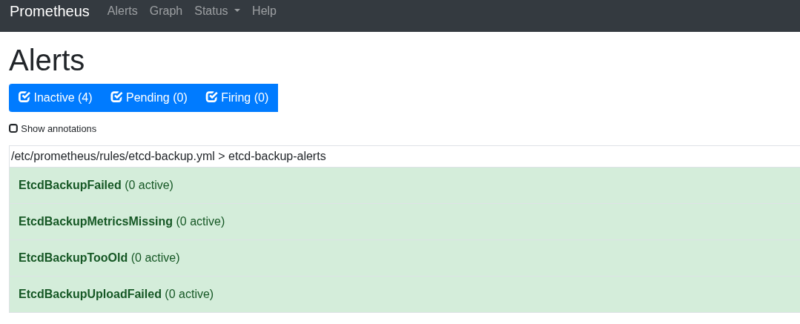
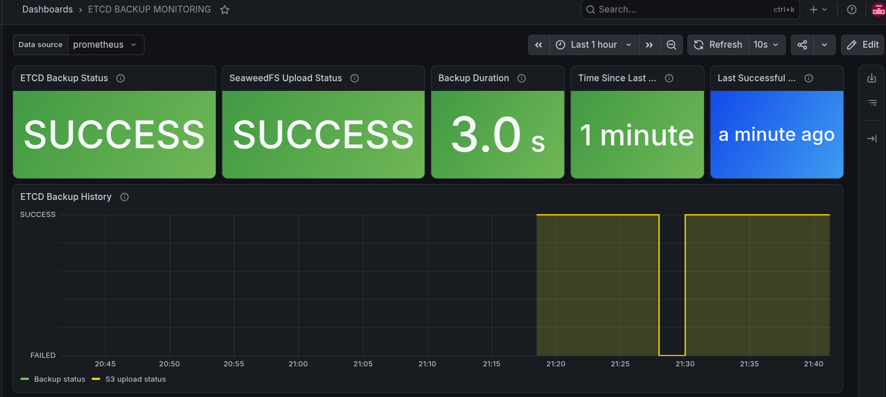

# 07. ETCD Backup Monitoring with Prometheus and Grafana

## 1. Overview

This document describes the implementation of an automated etcd backup monitoring solution for a highly available Kubernetes cluster.

The objective is to automate etcd backups, encrypt backup files, store them remotely using SeaweedFS (S3-compatible storage), and monitor the entire backup process using Prometheus and Grafana.

This implementation also includes alerting rules to detect backup failures and missing monitoring metrics. The monitoring configuration is currently being tested with a temporary backup schedule of every 10 minutes.

---

## 2. Infrastructure Architecture

### Infrastructure components

| Component | IP address | Role |
| :--- | :--- | :--- |
| **master1** | 192.168.56.11 | Kubernetes control plane, etcd and backup execution |
| **master2** | 192.168.56.12 | Kubernetes control plane and etcd |
| **master3** | 192.168.56.13 | Kubernetes control plane and etcd |
| **worker1** | 192.168.56.21 | Kubernetes worker |
| **worker2** | 192.168.56.22 | Kubernetes worker |
| **monitoring** | 192.168.56.40 | Prometheus, Grafana and SeaweedFS |

### Backup architecture

The backup process follows these steps:
1. Create an etcd snapshot on `master1`.
2. Validate the snapshot using `etcdutl`.
3. Encrypt the snapshot using `age`.
4. Upload the encrypted backup to SeaweedFS through its S3-compatible API.
5. Verify the uploaded object.
6. Publish backup monitoring metrics through Node Exporter.
7. Collect metrics using Prometheus.
8. Display monitoring information and alerts in Grafana/Prometheus.

---

## 3. etcd Backup Configuration

### Backup script

**Location:** `/usr/local/bin/etcd-backup.sh`

The script performs the following operations:
- Connects to the local etcd endpoint.
- Creates an etcd snapshot.
- Validates the snapshot.
- Encrypts the snapshot using `age`.
- Uploads the encrypted file to SeaweedFS.
- Verifies the remote object.
- Applies local backup retention.

The etcd endpoint used is: `https://127.0.0.1:2379`

TLS authentication uses the Kubernetes etcd certificates:
- `/etc/kubernetes/pki/etcd/ca.crt`
- `/etc/kubernetes/pki/etcd/healthcheck-client.crt`
- `/etc/kubernetes/pki/etcd/healthcheck-client.key`

The snapshot files are stored locally under: `/var/backups/etcd/`

### Encryption

The `age` encryption tool is used to protect backup files.
- The public recipient is stored on `master1`: `/etc/etcd-backup-recipient.txt`
- The private age identity is stored on the monitoring server: `/etc/etcd-backup/age-identity.txt`

> **Warning:** The private key must never be committed to Git or stored alongside the encrypted backups.

### Remote storage

SeaweedFS is deployed on the `monitoring` VM using Docker Compose.
- **S3 endpoint:** `http://192.168.56.40:8333`
- **Bucket:** `etcd-backups`

Encrypted backup files use the `.db.age` extension.

---

## 4. Automated Backup Execution with systemd

Two systemd units are used.

### Backup service

**File:** `/etc/systemd/system/etcd-backup.service`

```ini
[Unit]
Description=Sauvegarde automatique etcd vers SeaweedFS
Wants=network-online.target
After=network-online.target

[Service]
Type=oneshot
User=root
ExecStart=/usr/local/bin/etcd-backup-monitor.sh
```
The service executes the monitoring wrapper, which calls the original backup script.

### Backup timer

**File:** `/etc/systemd/system/etcd-backup.timer`

Current test configuration:
```ini
[Unit]
Description=Timer de test des sauvegardes etcd toutes les 10 minutes

[Timer]
OnCalendar=*:0/10
Persistent=false
Unit=etcd-backup.service

[Install]
WantedBy=timers.target
```
This schedules backup executions at minutes 00, 10, 20, 30, 40 and 50 of every hour.

### Useful systemd commands

```bash
# Check timer status
systemctl status etcd-backup.timer

# Display the next scheduled execution
systemctl list-timers etcd-backup.timer

# Execute a backup manually
sudo systemctl start etcd-backup.service

# Check service status
sudo systemctl status etcd-backup.service

# Display backup logs
sudo journalctl -u etcd-backup.service -n 50 --no-pager

# Follow logs in real time
sudo journalctl -u etcd-backup.service -f
```

> **Important:** The 10-minute schedule is temporary and intended for testing. The production schedule will be restored to once per day at 02:00 after monitoring validation.

---

## 5. Node Exporter Installation

Prometheus Node Exporter is installed on the three Kubernetes control-plane nodes.

| Node | Exporter port | Status |
| :--- | :--- | :--- |
| **master1** | 9100 | Active |
| **master2** | 9100 | Active |
| **master3** | 9100 | Active |

The exporter is installed through Debian packages:
```bash
sudo apt update
sudo apt install -y prometheus-node-exporter
sudo systemctl enable --now prometheus-node-exporter
```

Verification:
```bash
curl http://localhost:9100/metrics
sudo systemctl status prometheus-node-exporter
```

---

## 6. Custom Backup Metrics

The Node Exporter textfile collector is used to expose custom backup metrics.

### Configuration

**File:** `/etc/default/prometheus-node-exporter`
```text
ARGS="--collector.textfile.directory=/var/lib/prometheus/node-exporter"
```

The metrics directory is: `/var/lib/prometheus/node-exporter/`

Set directory permissions and restart Node Exporter:
```bash
sudo install -d -o prometheus -g prometheus -m 755 /var/lib/prometheus/node-exporter
sudo systemctl restart prometheus-node-exporter
```

### Monitoring script

**Location:** `/usr/local/bin/etcd-backup-monitor.sh`

The monitoring wrapper executes the backup script and publishes custom Prometheus metrics.
- **Persistent state:** `/var/lib/etcd-backup-monitor/state`
- **Metrics file:** `/var/lib/prometheus/node-exporter/etcd_backup.prom`

### Current metrics

| Metric | Description |
| :--- | :--- |
| `etcd_backup_last_status` | Status of the latest backup attempt |
| `etcd_backup_last_success_timestamp` | Timestamp of the last successful backup |
| `etcd_backup_last_attempt_timestamp` | Timestamp of the last backup attempt |
| `etcd_backup_duration_seconds` | Duration of the latest backup attempt |
| `etcd_backup_upload_status` | Status of the latest upload |

**Metric values:**
- `1`: successful operation
- `0`: failed operation

**Check custom metrics:**
```bash
curl -s http://localhost:9100/metrics | grep '^etcd_backup_'
sudo cat /var/lib/etcd-backup-monitor/state
```

---

## 7. Prometheus Configuration

Prometheus runs on the `monitoring` VM.

**Configuration file:** `/etc/prometheus/prometheus.yml`

### The monitoring jobs include:

**Kubernetes masters**
```yaml
  - job_name: "kubernetes-masters"
    static_configs:
      - targets: ["192.168.56.11:9100"]
        labels:
          server: "master1"
          role: "control-plane"
      - targets: ["192.168.56.12:9100"]
        labels:
          server: "master2"
          role: "control-plane"
      - targets: ["192.168.56.13:9100"]
        labels:
          server: "master3"
          role: "control-plane"
```

**etcd backup monitoring**
```yaml
  - job_name: "etcd-backup"
    static_configs:
      - targets: ["192.168.56.11:9100"]
        labels:
          server: "master1"
          role: "etcd-backup"
```

### Prometheus rules

- **Rules directory:** `/etc/prometheus/rules/`
- **Rules file:** `/etc/prometheus/rules/etcd-backup.yml`

Prometheus configuration includes:
```yaml
rule_files:
  - /etc/prometheus/rules/*.yml
```

**Validate and restart:**
```bash
sudo promtool check config /etc/prometheus/prometheus.yml
sudo systemctl restart prometheus
```

### Useful PromQL queries

```promql
# Backup status:
etcd_backup_last_status{job="etcd-backup"}

# Upload status:
etcd_backup_upload_status{job="etcd-backup"}

# Backup duration:
etcd_backup_duration_seconds{job="etcd-backup"}

# Time since last successful backup:
time() - etcd_backup_last_success_timestamp{job="etcd-backup"}

# Last successful backup timestamp:
etcd_backup_last_success_timestamp{job="etcd-backup"}

# Check exporter availability (Expected result: 1):
up{job="etcd-backup"}
```

---

## 8. Prometheus Alerting Rules

The alert rules file is: `/etc/prometheus/rules/etcd-backup.yml`

### Configured alerts

| Alert | Purpose |
| :--- | :--- |
| **EtcdBackupFailed** | Detects a failed backup attempt |
| **EtcdBackupUploadFailed** | Detects an upload failure |
| **EtcdBackupTooOld** | Detects a backup older than 26 hours |
| **EtcdBackupMetricsMissing** | Detects missing backup metrics |

**Example rule:**
```yaml
- alert: EtcdBackupTooOld
  expr: time() - etcd_backup_last_success_timestamp > 93600
  for: 5m
  labels:
    severity: critical
  annotations:
    summary: "Sauvegarde etcd trop ancienne"
    description: "Aucune sauvegarde etcd réussie depuis plus de 26 heures."
```
*(The 26-hour threshold is designed for the planned daily backup schedule, not the temporary 10-minute test schedule).*

Prometheus alerts can be inspected at: `http://192.168.56.40:9090/alerts`

Example Prometheus alerts:

[](../screenshots/Prometheus_alerts.png)

---

## 9. Grafana Dashboard

- **Dashboard name:** ETCD BACKUP MONITORING
- **Grafana address:** `http://192.168.56.40:3000`
- **Data source:** Prometheus
- **Dashboard refresh interval:** 10 seconds
- **Time range:** Last 1 hour

### Dashboard

An existing dashboard is available at: `../monitoring/etcd-backup-dashboard/etcd-backup-dashboard.json`

#### Dashboard panels

**Current status:**
- ETCD Backup Status
- SeaweedFS Upload Status
- Backup Duration
- Time Since Last Successful Backup
- Last Successful Backup

**Backup statistics:**
- Successful Backups
- Failed Backups
- Local Backup Files
- Remote Backup Files
- Last Backup Size
- Success Rate (24h)

**Schedule and 24-hour trends:**
- Next Scheduled Backup
- Successful Backups (24h)
- Failed Backups (24h)

**History:**
- ETCD Backup History
- Backups per Hour

<!-- > **Known improvement:** The *Success Rate (24h)* panel currently displays "No data". Its underlying counter metrics and PromQL calculation still need to be validated. -->

---

## 10. Failure Simulation and Validation

A controlled failure simulation was performed to validate the alerting mechanism.

### Test procedure
1. Stop the temporary backup timer.
    ```bash
    sudo systemctl stop etcd-backup.timer
    systemctl is-active etcd-backup.timer
    ```
2. Save a copy of the current metrics file.
    ```bash
    sudo cp \
    /var/lib/prometheus/node-exporter/etcd_backup.prom \
    /root/etcd_backup.prom.backup
    ```
3. Temporarily change the backup status metric from 1 to 0.
    ```bash
    sudo sed -i \
    -e 's/^etcd_backup_last_status 1$/etcd_backup_last_status 0/' \
    -e 's/^etcd_backup_upload_status 1$/etcd_backup_upload_status 0/' \
    /var/lib/prometheus/node-exporter/etcd_backup.prom
    ```
4. Verify the updated metrics through Node Exporter.
    ```bash
    curl -s http://localhost:9100/metrics | grep '^etcd_backup_'
    ```
5. Wait for the Prometheus alert evaluation.
6. Check the alert state.
7. Restore the original metrics file.
    ```bash
    sudo cp \
    /root/etcd_backup.prom.backup \
    /var/lib/prometheus/node-exporter/etcd_backup.prom
    ```
8. Execute a real backup.
    ```bash
    sudo systemctl start etcd-backup.service
    ```
9. Reactivate the timer.
    ```bash
    sudo systemctl enable --now etcd-backup.timer
    systemctl list-timers etcd-backup.timer
    ```
Example Prometheus alert after the failure simulation:

[](../screenshots/ETCD_backup.png)

### Simulation Results

| Scenario | Expected result |
| :--- | :--- |
| **Successful backup** | Status = 1 |
| **Failed backup simulation** | Status = 0 |
| **Backup failure alert** | Firing |
| **Metrics restored** | Status = 1 |
| **Recovery** | Alert returns to inactive |

This test validated the Prometheus alert rules without modifying the actual etcd database or performing a destructive restore.

---

## 11. Operational Verification Commands

```bash
# Check backup timer
systemctl list-timers etcd-backup.timer

# Check latest backup logs
sudo journalctl -u etcd-backup.service -n 50 --no-pager

# Check backup metrics
curl -s http://localhost:9100/metrics | grep '^etcd_backup_'

# Check persistent backup state
sudo cat /var/lib/etcd-backup-monitor/state

# Check local snapshots
sudo ls -lh /var/backups/etcd/
```

**Web Interfaces:**
- **Prometheus targets:** `http://192.168.56.40:9090/targets`
- **Prometheus alerts:** `http://192.168.56.40:9090/alerts`
- **Grafana dashboard:** `http://192.168.56.40:3000`

---

## Conclusion

This implementation provides an automated and monitored etcd backup workflow for a highly available Kubernetes cluster.

The solution combines systemd automation, etcd snapshots, `age` encryption, SeaweedFS S3 storage, Prometheus metrics and Grafana visualization. Backup success and failure scenarios have been tested, and Prometheus alert behavior has been validated.

<!-- The next objective is to improve backup observability, notification delivery, storage resilience and disaster recovery validation. -->